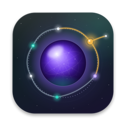
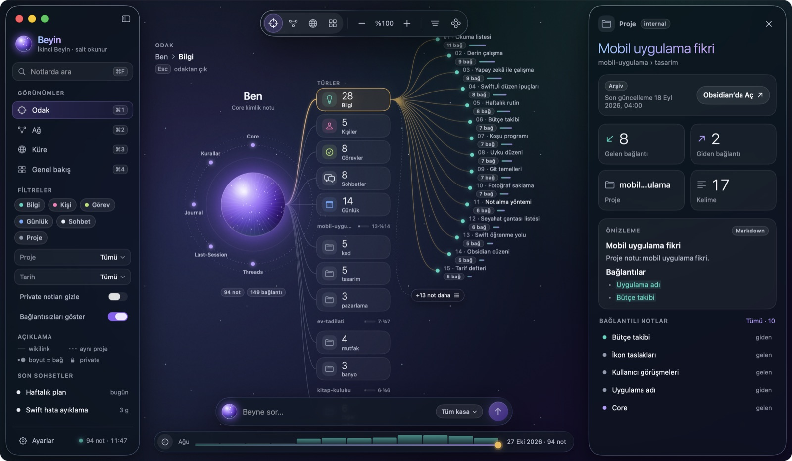
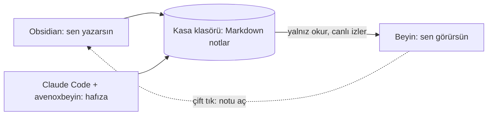
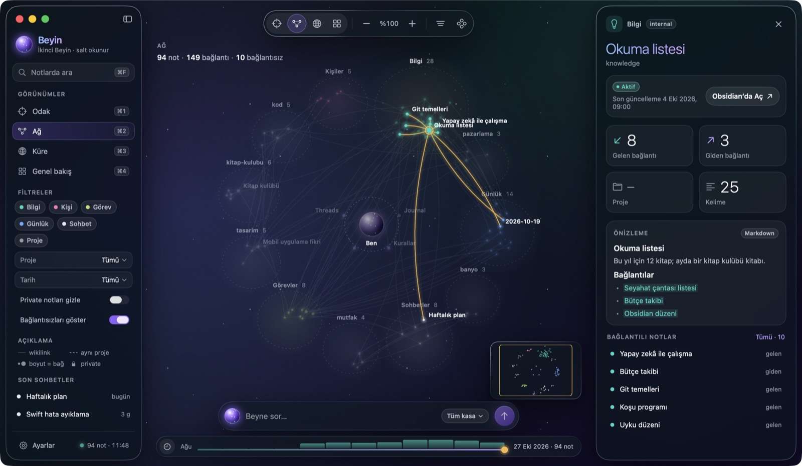
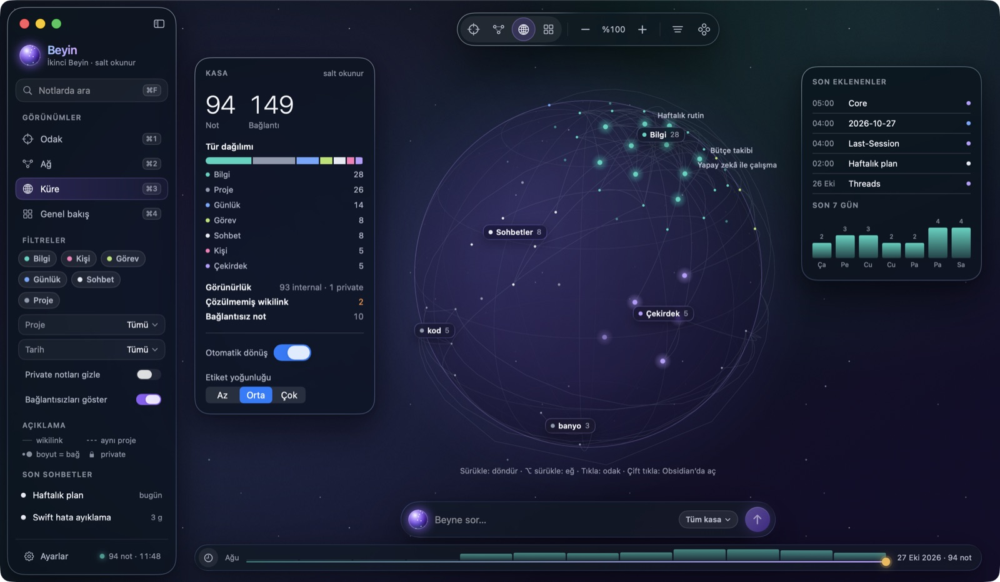
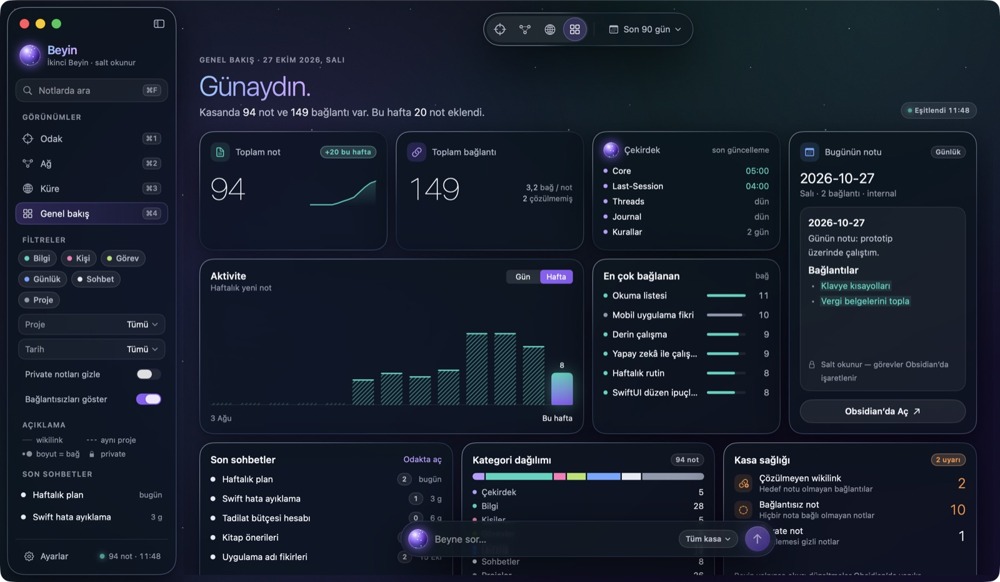

<p align="center">
  
</p>

<h1 align="center">Beyin</h1>

<p align="center">
  <b>İkinci beynini gör.</b><br>
  Obsidian kasanı canlı bir ağ, dönen bir küre ve günlük bir özet olarak gösteren, salt okunur bir macOS uygulaması.
</p>

<p align="center">
  <a href="https://github.com/yigit2015/beyin-mac/releases/latest"></a>
  
  
  <a href="https://github.com/yigit2015/beyin-mac/actions/workflows/test.yml"></a>
  <a href="LICENSE"></a>
</p>

<p align="center">
  <a href="https://github.com/yigit2015/beyin-mac/releases/latest/download/Beyin.zip"><b>İndir</b></a> ·
  <a href="https://yigit2015.github.io/beyin-mac/"><b>Adım adım kurulum</b></a> ·
  <a href="#english">English</a>
</p>



<p align="center"><sub>Ekran görüntüleri uydurma bir <a href="Ornek-Kasa">örnek kasadan</a> alındı.</sub></p>

## Neden?

Notlar Obsidian'da yazılır, Claude Code gibi ajanlar [avenoxbeyin](https://github.com/avenoxai/avenoxbeyin) ile
onları her oturumda okur. Ama kasa büyüdükçe neyin nereye bağlandığını görmek zorlaşır. Beyin kasanı okur ve dört
görünümde gösterir. Sayılar elle yazılmaz; klasör değiştikçe kendiliğinden güncellenir.



| Ağ | Küre |
|---|---|
|  |  |
| Her proje ve tür kendi kümesinde; bir nota tıkla, bağlantıları parlasın. | Kasanın yavaşça dönen 3B haritası; sürükleyerek döndür. |

| Genel bakış |
|---|
|  |
| Haftalık aktivite, en çok bağlanan notlar, bugünün notu ve çözülmemiş bağlantılar gibi kasa sağlığı uyarıları. |

## Gizlilik

- **Asla yazmaz.** Uygulama kasandaki hiçbir dosyayı değiştirmez; düzenleme Obsidian'da yapılır.
- **İnternete çıkmaz.** Ağ isteği, hesap, analitik yok. "Beyne sor" cihazdaki yerel aramadır.
- `"visibility": "private"` notların içeriği gösterilmez ve aramaya girmez.

## Kurulum

Gereken: **macOS 26 (Tahoe)** veya üstü. Obsidian ve avenoxbeyin isteğe bağlı ama önerilir.

1. **Kasan yoksa** [Obsidian](https://obsidian.md)'ı kur ve bir kasa oluştur.
2. **İstersen avenoxbeyin'i kur.** Kasa klasörünü Claude Code'da aç ve şunu yaz:
   > https://avenox.lol/beyin.md adresini oku. Bu klasöre ikinci beynimi kur.

   Ayrıntılar: [avenoxbeyin kurulumu](https://github.com/avenoxai/avenoxbeyin#en-kolay-kurulum-bir-klasör-bir-mesaj).
3. **Beyin'i indir.** [Beyin.zip](https://github.com/yigit2015/beyin-mac/releases/latest/download/Beyin.zip) dosyasını
   indir, aç ve `Beyin.app`'i **Uygulamalar** klasörüne sürükle. Bu sürüm henüz Apple onaylı değil: ilk açılışta macOS
   uyarırsa **Sistem Ayarları › Gizlilik ve Güvenlik › Yine de Aç**. Terminal'den uyarısız kurmak için:
   ```bash
   curl -fsSLO https://github.com/yigit2015/beyin-mac/releases/latest/download/Beyin.zip
   ditto -x -k Beyin.zip /Applications && open /Applications/Beyin.app
   ```
4. **Aç ve kasanı seç.** Varsayılan klasör `~/Beyin`. Kasan başka yerdeyse açılış ekranındaki
   **Başka klasör seç…** düğmesini kullan; seçim hatırlanır, sonra **Ayarlar**'dan değiştirebilirsin.

Notlarını açmadan denemek için [Ornek-Kasa.zip](https://github.com/yigit2015/beyin-mac/releases/latest/download/Ornek-Kasa.zip)'i indir, aç ve o klasörü seç.

### Kısayollar

| Kısayol | İş |
|---|---|
| ⌘1 · ⌘2 · ⌘3 · ⌘4 | Odak · Ağ · Küre · Genel bakış |
| ⌘F / ⌘L / ⌘K | Notlarda ara / Beyne sor / Komut paleti |
| ⌘O, çift tık | Seçili notu Obsidian'da aç |
| ⌘R | Kasayı yeniden oku |
| ⌘+ ⌘− ⌘0 | Yakınlaştır, uzaklaştır, sıfırla |
| ⌥⌘I · ⌃⌘S | İnceleme paneli · kenar çubuğu |

## Hangi kasalarla çalışır?

- **avenoxbeyin kasası** (kökte `🔮 850-Companion` var): çekirdek notlar (Core, Kurallar, Last-Session, Threads,
  Journal), `projects/<proje>/<alt>` kümeleri, `daily/`, `tasks/`, `notes/kisiler/` ve frontmatter'daki `kind`
  (`fact`, `person`, `task`, `daily`) tanınır.
- **Herhangi bir Obsidian kasası:** her üst klasör bir küme, ikinci seviye klasörler alt küme olur.
  `[[wikilink]]`'ler Obsidian gibi çözülür (ada göre, büyük/küçük harf duyarsız).

JSON ve basit YAML frontmatter okunur. Gizli klasörler (`.obsidian`, `.claude`…) ve `📋 Templates` atlanır.

## İsteğe bağlı: Claude Code sohbetlerini kasaya arşivle

[`extras/sohbet-arsivi`](extras/sohbet-arsivi) her Claude Code konuşmasını kasandaki
`projects/sohbet-arsivi/` klasörüne Markdown olarak yazar; Beyin bunları **Sohbetler** olarak gösterir.

> Bu, konuşmanın **tam metnini** diske yazar. API anahtarı ve token gibi kalıplar maskelenir ama her şeyi
> yakalayamaz. avenoxbeyin'in kendi sohbet izi bilerek yalnız üst bilgi tutar; hangisini istediğine sen karar ver.

Kurulum ve kapatma adımları: [extras/sohbet-arsivi/README.md](extras/sohbet-arsivi/README.md).

## Kaynaktan derleme

Xcode 26 (Swift 6.2+) gerekir.

```bash
git clone https://github.com/yigit2015/beyin-mac.git
cd beyin-mac
swift test                      # çekirdek testleri
Scripts/package_app.sh          # Beyin.app oluşturur
open Beyin.app
```

Geliştirirken `BEYIN_VAULT=/yol/kasa` ile başka bir kasa, `BEYIN_PREVIEW=1` ile önizleme verisi açılır.
`python3 Scripts/ornek_kasa.py` örnek kasayı yeniden üretir.

## Teşekkür ve bağlantı

Beyin, [avenoxbeyin](https://github.com/avenoxai/avenoxbeyin)'in (MIT) klasör ve frontmatter düzenini okur; onun
kodunu içermez ve çalıştırmaz. **Avenox ile resmi bir bağı yoktur**, topluluk tarafından yapılmış bir araçtır.

Hata ve öneriler için [issue](https://github.com/yigit2015/beyin-mac/issues) açabilirsin.

## Lisans

[MIT](LICENSE)

---

## English

**Beyin** ("brain" in Turkish) is a read-only macOS app that visualizes an Obsidian vault as a live network, a rotating
globe and an overview dashboard. It understands the [avenoxbeyin](https://github.com/avenoxai/avenoxbeyin) second-brain
layout and works with any Obsidian vault (top-level folders become clusters).

- Never writes to your vault, makes no network requests, hides `private` notes.
- Requires macOS 26 (Tahoe). Download [Beyin.zip](https://github.com/yigit2015/beyin-mac/releases/latest/download/Beyin.zip),
  drag `Beyin.app` to Applications, pick your vault folder. The build is not notarized yet: on first launch use
  System Settings › Privacy & Security › Open Anyway.
- Build from source: `swift test && Scripts/package_app.sh`.
- The UI is in Turkish. Unofficial community project, not affiliated with Avenox. MIT licensed.
